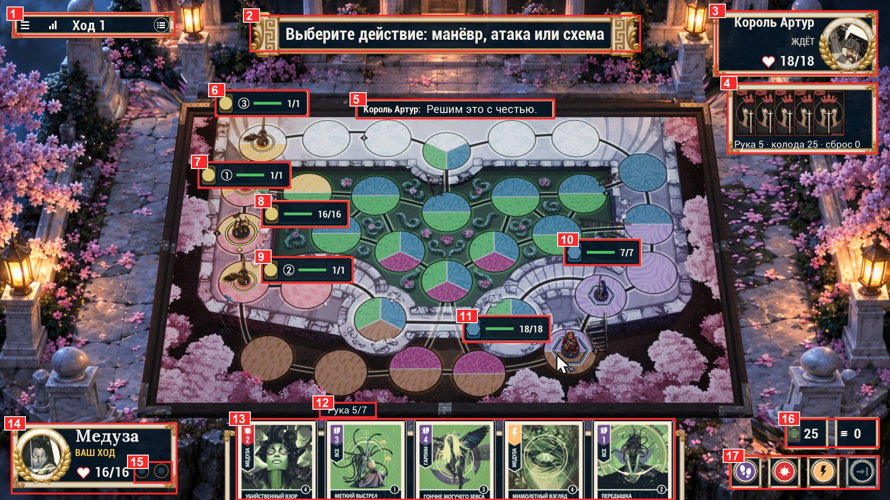

# 01 · Арт-директорский осмотр текущего HUD

Дата: 2026-10-16. Сборка: пакет `02bdd4e0` + шрифт Philosopher (`c09b6cb8`). Доска Marmoreal, Медуза против Короля Артура.
Источники кадров: `frames/A0-current-1080p.jpg` (живой клиент 1920×1080, 2026-10-15 23:48),
`../evidence/PLAYTEST-2026-10-15/*.jpg` (лист пяти разрешений, бой, защита, выбор цели, лобби, комната, итог).
Факты и цифры из кода — в [research/I1-hud-inventory.md](research/I1-hud-inventory.md), история попыток — в
[research/I2-iteration-history.md](research/I2-iteration-history.md).

Запрос пользователя: «игра выглядит откровенно по-детски, касательно именно худа… всё выглядит очень дешево… нет
визуального единообразия и сходства с реальными настольными играми… Magic the Gathering… очень много лишних иконок,
непонятное расположение».

---

## 1. Вердикт в одном абзаце

Сцена и карты выглядят как продукт: нарисованная карта Marmoreal, 3D-фигуры, иллюстрированные карты в языке Mondo.
HUD выглядит как набор независимых виджетов админ-панели, положенных поверх продукта. Каждый виджет — тёмно-синий
прямоугольник в кремово-золотой рамке. Каждый сделан отдельно, со своим кеглем, своей рамкой и своими значками.
Между ними нет общей сетки, иерархии и физического «предмета» настольной игры. Отсюда «на коленке»: ни один элемент
не ужасен сам по себе, но около 20 рамок одинакового веса (10 видов), 12 цветовых ролей и 37 значков примерно 20
родов (счёт I1 и 06 §5) дают визуальный шум.
Шум спорит с доской и прячет единственный вопрос хода: «что мне сейчас делать?». Точечные правки (рамки x2, кегли,
теги гарпий, шрифт) этого не лечат. Нужна пересборка от системы, а не от виджетов.

## 2. Аннотированный кадр

| № | Элемент | Что не так |
|---|---|---|
| 1 | Верхняя полоса: ☰, значок сигнала, «Ход 1», значок списка | Четыре разнородных объекта в одной рамке. Сигнал сети и кнопка журнала — служебные, им не место в главной зоне. «Ход 1» — единственная полезная вещь, и она набрана тем же весом, что и значки. |
| 2 | Баннер-подсказка «Выберите действие: манёвр, атака или схема» | Самый крупный текст экрана — это инструкция, а не игра. Торцы с меандром есть только тут: декор, которого нет больше нигде. Подсказка далеко от места действия (рука и кнопки внизу). |
| 3 | Плашка соперника (имя, «ЖДЁТ», ♥ 18/18, портрет в лавровом венке) | Лавровый венок — медаль мобильной игры. Статус «ЖДЁТ» серым капслоком без смысла для игрока. Помощник (Мерлин) то есть, то нет. |
| 4 | Рука соперника в рамке + строка «Рука 5 · колода 25 · сброс 0» | Пять рубашек в коробке — так не выглядит ни одна настольная или карточная игра. Строка текста легла на нижнюю рамку. Колода и сброс соперника — текстом, свои — плитками (два разных языка для одной сущности). |
| 5 | Реплика «Король Артур: Решим это с честью.» | Ещё одна рамка, теперь на самой доске. Флейвор оформлен как системное сообщение. |
| 6–11 | Шесть плашек над фигурами: жетон, цифра в круге, зелёная полоса, «1/1» | Главный источник «дешевизны» на доске. Шесть прямоугольников 190×55 закрывают клетки карты. Зелёная полоса HP — язык MMO, не настолки. Для гарпий с 1/1 полоса бессмысленна. HP героев дублирует плашки 3 и 14. Синий шестиугольник Артура и жёлтая монета Медузы — третий и четвёртый способ обозначить команду. |
| 12 | Ярлык «Рука 5/7» | Отдельная рамка ради подписи. Предел 7 нужен только при сбросе. |
| 13 | Веер руки | Сами карты — лучшее, что есть на экране. Но видна только верхняя половина: название внизу обрезано краем экрана, текст эффекта не виден вовсе. Рамки карт (кремовая обводка) не совпадают с рамками HUD. |
| 14 | Своя плашка героя | Тот же лавровый венок. Портрет-рендер 3D-модели мелкий и серый. «ВАШ ХОД» жёлтым капслоком — третий цвет текста в одной плашке. |
| 15 | Два пустых кружка | Непонятно, что это (жетоны действий? эффекты?). Пустой контейнер без подписи — классический признак «собрано на коленке». |
| 16 | Колода 25 / сброс 0 | Две отдельные рамки. Значок колоды — миниатюра рубашки, значок сброса — три чёрточки: два разных рода значков рядом. |
| 17 | Кнопки МАНЁВР / АТАКА / СХЕМА / КОНЕЦ ХОДА | Четыре квадрата 60×60, в каждом круг, в круге значок, вокруг кольцо: рамка в рамке в рамке. Фиолетовый, красный, оранжевый, серый — четыре новых цвета. Подписи появляются не на всех разрешениях. Главные решения хода спрятаны в правом нижнем углу и имеют вес жетона. «Конец хода» визуально равен атаке. |

## 3. Оценка по осям (1–10)

| Ось | Балл | Почему |
|---|---|---|
| Иерархия | 3 | Самый крупный объект — подсказка-инструкция. Главные действия — самые мелкие. Всё в рамках одного веса. |
| Единообразие системы | 3 | 10 видов рамок (I1 §2.2): плита хода, картуш с меандром, панель с акантом, медальон с лаврами, лоток руки, рамка карты, фишка, оправа диска, тег, капсула. Свой кегль у каждого виджета. |
| Связь с настольной игрой | 2 | Ни одного физического компонента: нет планшета героя, нет счётчика здоровья-диска, нет стопок колоды и сброса, рука соперника в коробке. HUD — «интерфейс приложения», не «стол». |
| Иконография | 3 | 37 значков в кадре старта хода (I1), минимум 4 рода: плоские глифы, цветные медальоны, цифры в кругах, миниатюры карт. Много значков без подписи и без пользы (сигнал, пустые круги, жетон-монета). |
| Типографика | 4 | Philosopher для имён — шаг вперёд. Но рядом Roboto, Roboto Condensed, капсы трёх цветов (белый, жёлтый, серый), кегли от 12 до 34 px без шкалы. |
| Цвет | 3 | Тёмно-синий, крем, золото, жёлтый, бирюза (лобби), фиолетовый, красный, оранжевый, зелёный HP, красное сердце, синий гекс. Доска и так пёстрая (розовый, зелёный, голубой, сирень), и HUD добавляет к ней свою радугу. |
| Сетка и выравнивание | 3 | Плашки разной высоты, разные поля, разный отступ от краёв. На 1440×1080 и 2560×1080 кадр уходит в чёрные поля. HUD прижат к 16:9, а не к краям экрана. |
| Уважение к доске | 3 | Плашки HP, реплика и баннеры лежат на поле и закрывают клетки. Доска — главный арт игры, и HUD с ней спорит. |
| Обратная связь и состояния | 5 | Логика состояний сделана тщательно (защита, бой, выбор цели, отказы). Подача сухая: тексты-инструкции, панели с кнопками «(X)», «(C)» — вид отладочного инструмента. |
| Масштаб и разрешения | 5 | Технически работает от 720p до 3840×1080 и при UI 150 %. Стиль при этом не меняется: просто мельче или крупнее. |

Средний балл ≈ 3.4. Главные провалы — система, связь с настолкой, иконография, цвет.

## 4. Корневые причины

1. **Нет визуальной концепции HUD как объекта.** Сцена задумана как стол (диорама на подносе, доска, фигуры). HUD
   не продолжает её. Нет ответа на вопрос «из чего сделан интерфейс»: из картона, бронзы, бумаги? Поэтому по
   умолчанию он сделан из «веб-панели».
2. **Виджет-центричная разработка.** Каждый блок (`-S08SlateHud=top,panels,hand,combat,slot,actions,log,toast,pending,…`)
   жил своей жизнью: свой заказ, своя приёмка, свой фикс. Общего грида, шкалы кеглей и бюджета значков на экран нет.
3. **Значок как способ сэкономить место, а не как язык.** Значки v3 сами по себе аккуратные. Но их стало слишком
   много: значок ставили туда, где не хватало места на слово. Отсюда ребусы — кнопки без подписей, пустые круги,
   монеты-жетоны.
4. **Информация дублируется вместо того, чтобы жить в одном месте.** HP в двух местах, колода и сброс двумя языками,
   стадия хода в баннере, а теперь ещё и в полосе стадий (HB-50).
5. **Приёмка по метрикам и разрешениям, а не по виду.** Итерации закрывали измеримые пункты: рамка x2 по пикселям,
   тег гарпии не перекрывает фигуру, одна строка при 150 %. Вопрос «выглядит ли это как дорогая настольная игра»
   ни разу не был критерием приёмки.
6. **Нет референс-борда.** Ни один документ не ставит рядом наш кадр и кадр MTG Arena, Hearthstone, Root или
   Unmatched DE. Стиль собирался из словесных токенов (`hud-style-tokens.json`), а не из образца.

## 5. Что сохранить

- **Карты.** Рамки, плашка значения, BOOST-круг, вертикальная полоса типа с именем бойца — это язык настоящего
  Unmatched, и он выглядит дорого. HUD должен говорить на этом языке, а не наоборот.
- **Доска и сцена** (нарисованный задник Marmoreal, lit3d Sarpedon) — не трогаем.
- **Philosopher Bold** для имён и заголовков — оставляем как дисплейную гарнитуру. Текстовый шрифт пересматриваем.
- **Значки v3 в языке Unmatched DE** — как библиотека глифов. Количество на экране режем.
- **Логика состояний HUD** (защита, бой, выбор цели, отказы, переподключение) — она правильная, меняется подача.
- **Система флагов отката** (`-S08SlateHud=<block>`) — пересборка идёт тем же путём: новый вид по умолчанию,
  старый за флагом.

## 6. Что убрать или перенести (кандидаты)

| Что | Решение-кандидат |
|---|---|
| Значок сигнала в верхней полосе | Убрать. Показывать только при плохой связи. |
| Плашки HP над фигурами (6 шт.) | Убрать постоянные. Над фигурой — маленький диск-счётчик HP только у раненых или при наведении; у гарпий — ничего. |
| Лавровые венки портретов | Убрать. Портрет — иллюстрация в рамке карты героя. |
| Пустые кружки на плашке героя | Убрать или подписать, если это жетоны. |
| Рука соперника в рамке | Веер рубашек у верхнего края экрана, без коробки. |
| Колода и сброс плитками с цифрами | Физические стопки рядом с рукой; число на торце стопки. |
| Баннер-инструкция сверху | Заменить подсказкой в месте действия и одной главной кнопкой. |
| Четыре кнопки-значка | Три карточки-действия с подписью у руки. «Конец хода» — отдельная главная кнопка, которая меняет смысл по фазе. |
| Ярлык «Рука 5/7» | Убрать. Предел показывать только при сбросе. |
| Пустой журнал-коробка слева | Свернуть в узкую ленту событий, раскрывать по запросу. |
| Кнопки «(X)» и «(C)» в панелях выбора | Убрать хоткеи из подписей. Подсказка клавиш — в тултипе. |
| Реплика героя в рамке на доске | Облачко-цитата у портрета героя, без рамки, курсивом. |

## 7. Экраны вне партии

- **Лобби** (`02-lobby.jpg`): веб-форма. Пустой чёрный список на 60 % экрана, бирюзовые выделения, поле кода из шести
  подчёркиваний. Нет героев, нет арта, нет настроения игры.
- **Комната** (`03-room-ready.jpg`): тот же синий прямоугольник с двойной рамкой ×7. Карточки героев — правильная
  идея, но в них портрет-кружок и мелкий текст. «ГОТОВ» и «НАЧАТЬ ПАРТИЮ» — бирюзовый и жёлтый, третий и четвёртый
  стиль кнопок.
- **Итог** (`09-result-victory.jpg`): лучший из экранов (крупное «ПОБЕДА», два портрета). Но это тоже синяя панель
  с тремя разными кнопками.

## 8. Цель пересборки (как поймём, что стало лучше)

1. В типичном кадре хода не больше **12** значков в покое, и у каждого есть смысл без тултипа (сейчас 37; концепт v2
   — 16, с резервом до 12, 03 §6).
2. Не больше **5** видов рамок на весь HUD, и все из одного материала (сейчас 10).
3. Не больше **2** цветов акцента UI сверх командных (сейчас 6+).
4. Главное действие хода видно за 1 секунду: самый контрастный объект экрана — то, что игрок должен нажать сейчас.
5. Доска закрыта HUD-ом в покое не больше чем на **5 %** площади поля (сейчас плашки, реплика и баннер закрывают
   заметно больше; точная цифра — по маске в I1).
6. Слепой тест: показать кадр человеку без контекста. Ответ «цифровая настольная игра уровня Arena или DE», а не
   «мобилка» или «инди-прототип».

Концепт пересборки — [03-CONCEPT.md](03-CONCEPT.md), референсы — [02-REFERENCES.md](02-REFERENCES.md).
Цифры этого осмотра сверены ревью и сведены в единую таблицу счёта [06 §5](06-REVIEW-RESOLUTION.md).
