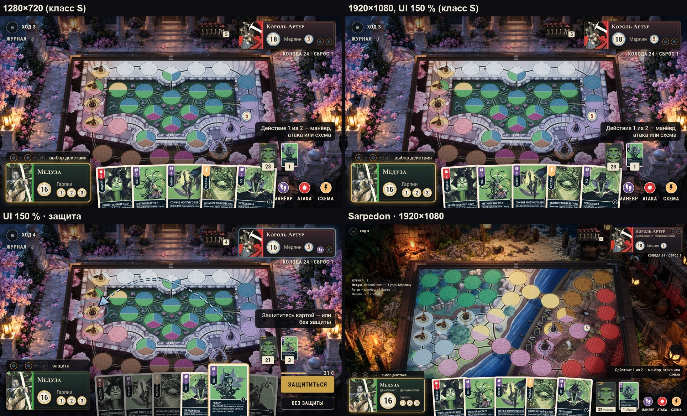

# 03 · Концепт пересборки HUD: «Стол, а не приложение» (v2)

Дата: 2026-10-16. Статус: **концепт v2 после двух адверсариальных ревью, на приёмку направления пользователем.**
v1 разобран в [04-REVIEW-OPUS](04-REVIEW-OPUS.md) и [05-REVIEW-ASTRA](05-REVIEW-ASTRA.md); что принято и что нет —
[06-REVIEW-RESOLUTION](06-REVIEW-RESOLUTION.md). Основание: [01-INSPECTION](01-INSPECTION.md),
[02-REFERENCES](02-REFERENCES.md), отчёты `research/` (особенно R3 — канон коробки Unmatched и DE).

Макеты — [mockups/](mockups/): HTML поверх реального кадра Marmoreal / Sarpedon, реальные карты, аватары, значения
карт из бэкенда, диски DE-012. Все кадры — один согласованный снимок партии (докстрока
[`gen_table.py`](mockups/gen_table.py)). Пересборка:
`python docs/game-design/hud-redesign/mockups/gen_table.py && python docs/game-design/hud-redesign/mockups/render.py && python docs/game-design/hud-redesign/mockups/sheets.py`.


---

## 0. Идея

1. **HUD — компоненты коробки Unmatched на краю стола:** карточка героя в цвете героя с диском здоровья, полоса
   стадий хода с жетонами действий, рука, стопки колоды и сброса. Чего в коробке нет (журнал, сигнал сети, рамки
   вокруг кнопок) — не получает постоянного места.
2. **Каркас тихий:** один материал (выбор — по образцам, §5.1), одна рамка «как у карты», без лавров, меандров,
   накладок. Центр отдан доске, верх — событиям, правая нижняя колонка — решениям.
3. **Один вопрос и одна главная кнопка в каждом состоянии,** оба в колонке решений, рядом с ответом и вне поля.
4. **Правила игры не меняются.** Ход передаётся сам после второго действия, атака уходит по клику на цель (SD-56),
   нелегальное не рисуется.

## 1. Десять правил (проверяемых по кадру)

| # | Правило | Сейчас (A0) → v2 (A1) |
|---|---|---|
| Р-1 | Постоянных зон HUD вне боя ≤ 7 | 12 блоков + 6 тегов → 7 зон (Z1–Z7) |
| Р-2 | Видов рамок ≤ 5: карточка, плашка текста, диск, бирка, кнопка; без «рамки в рамке» | 10 → 5 |
| Р-3 | Значки: в покое ≤ 12 экземпляров и ≤ 7 классов; шаг добавляет ≤ 3 класса; на клетке/фигуре ≤ 1 метки | 37 / ≈ 20 → 16 / 7 (резерв до 12 — §6) |
| Р-4 | Одна строка-вопрос (≤ 8 слов) и одна главная кнопка в состоянии; текст прошлого состояния не висит | 2–3 «заголовка» в бою → 1 |
| Р-5 | Нелегальное не рисуется: нет кнопки конца хода, нет кнопок хода в чужой ход, нет «Атаковать» после цели | — |
| Р-6 | (а) hit-зоны интерактивных клеток не перекрываются HUD никогда; (б) визуально HUD закрывает поле в покое ≤ 5 % (только метки HP у раненых) | 6 тегов, реплика, баннер на поле → диск у раненого |
| Р-7 | Хром нейтральный; смыслы цвета: золото C-11 = P1, сланец C-11 = P2, холодный светлый = «можно выбрать», цвет героя = идентичность карточки; цвета типов карт и зон — только в картах и на поле | 12 ролей → 4 + цвета героев |
| Р-8 | Две гарнитуры (дисплей + Roboto/Condensed), 5 кеглей HUD (18 · 21 · 26 · 32 · 46), текст HUD ≥ 18 px эффективных при любом классе | 7 кеглей, подписи 12–14 px → ≥ 18 |
| Р-9 | Одна сущность — одна форма у обоих игроков: HP-диск, жетоны действий, веер карт с числом, «колода · сброс» | разные формы → одинаковые (соперник — компактнее) |
| Р-10 | Сетка 8 px, поля 24 px от края безопасной зоны 16:9; классы L / S | абсолютные блоки → классы с правилами сжатия (§2.2) |

## 2. Композиция

### 2.1 Класс L (холст 1920 × 1080 su)

```
┌──────────────────────────────────────────────────────────────────────────────────────────┐
│ ≡ Ход 3                        [событие: «Мерлин атакует Медузу»]   ▯▯▯▯5 ┌─────────────────┐│
│                                                                          │▌КОРОЛЬ АРТУР ◯◯ ││ Z2
│ Журнал · J                                                               │ [18]  Мерлин [5]││
│ Медуза: способность…              П О Л Е                                └─────────────────┘│
│ Артур — манёвр…           (подставки фигур; кольца, дуги,                колода 24 · сброс 1 │
│ Мерлин → 2 клетки          диски HP у раненых — контекстно)              [слот активной     │
│ Z4                                                                         карты соперника] │
│ [превью карты 270×376                                                                      │
│  при наведении]                                                    ┌──────────────────────┐│
│ ◯—◯—≤7  выбор действия   Z6a                                       │ Действие 1 из 2 — …  ││ Z7
│ ┌──────────────────┐  ╭──╮╭──╮╭──╮╭──╮╭──╮  ┌колода┐┌сброс┐       └──────────────────────┘│
│ │▌МЕДУЗА           │  │  ││  ││  ││  ││  │  │ ▓ 23 ││ ▢ 1 │   ⬤ Манёвр ⬤ Атака ⬤ Схема   │
│ │▌[16]  Гарпии ①②③ │  веер (видно 80 %)     └──────┘└─────┘   или [ГЛАВНАЯ] / [вторичная] │
└──────────────────────────────────────────────────────────────────────────────────────────┘
  Z6 карточка героя        Z5 рука             стопки              Z7 решение
```

| Зона | Что | Видно |
|---|---|---|
| Z1 | ≡ и «Ход N» (капс 18 px) | всегда |
| Z2 | карточка соперника 404 × 140 в цвете героя, его 2 жетона действий, веер рубашек с бирочкой числа, «колода · сброс»; под ней **слот активной карты** соперника (схема, BOOST, «после боя») | всегда; слот — пока идёт эффект |
| Z3 | событие одной строкой по центру сверху | только при событии |
| Z4 | журнал: заголовок «Журнал · J» + 3 последних события 18 px; превью карты при наведении — в этой же левой колонке | после первого события |
| Z5 | рука: веер, в покое видно 80 % высоты карты; поднятая/выбранная карта не заходит на поле | всегда |
| Z6 | карточка героя 420 × 184 (арт, полоса цвета героя, имя, «движение 3 · дальний бой», диск HP, метки помощников) + **полоса стадий** над ней (2 жетона, узел «≤ 7», подпись стадии) | всегда |
| Z7 | колонка решений справа: строка-вопрос, под ней диски действий (S1/S11) или главная + вторичная кнопка, таймер с секундами | всегда, содержимое по состоянию |

### 2.2 Класс S (холст 1280 × 720 su: 1920×1080 при UI 150 %, 1440×1080, предлагаемо 1280×720)



| Элемент | L | S |
|---|---|---|
| Карточка героя / соперника | 420 × 184 / 404 × 140 | 312 × 142 / 360 × 104, без строки свойств (она в справочнике) |
| Карта руки | 200 × 278, шаг ≤ 172 | 150 × 208, шаг сжимается до коридора |
| Стопки | 112 × 156 с подписью | 64 × 90, только число, над колонкой решений |
| Диски действий | 60 | 48 |
| Журнал | 3 строки | только «Журнал · J» (панель по запросу) |
| Вопрос | 420 px, над стопками | 300 px, над стопками |

**1280×720:** сейчас это «L низкий» при DPI 0,75 (холст 1706 × 960) — текст 18 su становится 13,5 px. Предложение:
выбирать класс S при DPI 1,0 (C1). Эффективные 18 px сохраняются, раскладка та же, что при UI 150 %.

## 3. Компоненты

### 3.1 Карточка героя (Z6, зеркально Z2)

- Альбомная выкладка карточки персонажа из коробки (R3 P-2): арт героя слева, **полоса в цвете героя** (бэкенд
  `Hero.color`: Медуза `#42AB47`, Артур `#E35456`), лёгкая тонировка тела тем же цветом; имя дисплейной гарнитурой;
  «движение 3 · дальний бой». Способность героя — по наведению на карточку и в справочнике (U-8).
- **Диск здоровья** — одно число, без дроби и сердца (R3 §3.5). Урон — «−N» вылетает из диска, ореол (перенос AB-6);
  павший — тёмный диск со штампом-крестом (AB-8). Цвет обода — команда.
- **Помощники:** многохитовые (Мерлин) — малый диск с HP; однохитовые (гарпии) — метки с номерами 1–3, как на
  подставках; погибшая метка тёмная и перечёркнута (A5). Диска HP у однохитовых нет — так и в коробке.
- **Чей ход** — обводка и свечение карточки в цвете команды + событие «Ваш ход» 1 с (B1). Замена кольца AB-5 —
  вопрос U-5.
- Клик — справочник героя (способность, колода, сброс). Клик по карточке соперника — его справочник.

### 3.2 Полоса стадий хода (HB-50 в компактной форме)

- Над своей карточкой: жетон действия 1 — жетон действия 2 — узел «≤ 7», справа подпись стадии.
- Жетоны — диски DE-012 (П-4): пустой слот → заливка значком типа. Узел «≤ 7»: пунктир «не нужен», контур «будет»,
  бумажный с золотом «сейчас» (A5).
- Подпись стадии — та же модель `S09TurnStrip::Build`, что у HB-50: «выбор действия», «атака: цель → защита →
  вскрытие», «после боя: «Рывок»», «защита: выберите карту», «ход соперника».
- У соперника — только 2 жетона на его карточке.

### 3.3 Рука (Z5)

- Веер, в покое видно 80 % карты: значение, тип, BOOST, название. Наведение: карта поднимается на 18 px со светлой
  обводкой, **крупное превью 270 × 376 — в левой колонке, не над полем** (A1b; ≥ ВР-70 225 × 312). ПКМ — инспектор.
- Играбельные в шаге карты — полный контраст; прочие — 35 % насыщенности (A2, A4). Выбранная — золотая обводка P1.
- Сброс до 7: отмеченные карты приподняты с красной меткой «сброс» (A5).
- В бою рука опускается (видно 62 %), но не исчезает (A3).

### 3.4 Колода и сброс

- Стопки с толщиной; колода — рубашка героя, сброс — верхняя карта; число на бумажной бирке.
- **Клик по колоде = манёвр** только в S1/S11, при наведении «Манёвр — взять 1 и двигаться» (добор необратим).
  Просмотр колоды — ПКМ. Пустая колода — пунктир и предупреждение «манёвр: 2 урона каждому вашему бойцу».
- Свой и чужой счётчики — одна форма данных (Р-9): у соперника «колода · сброс» строкой 18 px и бирка на веере.

### 3.5 Колонка решений (Z7)

- **Строка-вопрос**: светлый текст 21 px на плотной тёмной плашке с золотой нитью сверху; ≤ 8 слов, глагол первым.
- **S1/S11** — три диска DE-012 с подписями «Манёвр · Атака · Схема». Недоступный — контур без заливки, причина по
  наведению. Яркость дисков в покое — U-3.
- **Главная кнопка** — одна, заливка золотом P1, 220 × 64; вторичная — контур. Таймер защиты — полоса + секунды.
- **Выбор (pending)** — панель в Z7 с миниатюрой карты-источника, заголовком «Рывок · после боя» и текстом 18 px;
  поле и рука остаются интерактивными (B3). Хоткеи — в тултипе.

### 3.6 Поле

- В покое — только подставки (круг P1 / шестиугольник P2) и номера гарпий; диск HP у раненых (A1: «5» у Мерлина).
- **Выбор цели:** у всех кандидатов — бирка «имя · HP · без защиты −N» (−N = значение выбранной карты; с BOOST/
  эффектами — только если они открыты). «Смертельно» — отдельный вид бирки, только по открытым данным.
- **Атакующий** — золотое кольцо P1 (A2); **цели** — холодное сплошное; **досягаемые клетки** — холодный пунктир (B3);
  **угроза** — сланцевое кольцо + дуга от атакующего (сплошная — ближний, пунктир — дальний), наконечник ≈ 40 px с
  тёмной кромкой (A4).
- Одна метка на клетку/фигуру: цель > путь > угроза > подсказка.
- Реплики героев — в журнал и как событие у карточки 2 с, не рамкой на поле.

### 3.7 Бой

- **Вскрытие (A3):** две карты 270 × 376 рядом в центре, поле приглушено, счёт дисплейной цифрой, вердикт в 2 строки,
  лента тайминга словами карт («Немедленно · Во время боя · Урон −2 · После боя: оба берут карту»). Рука видна
  (опущена). 2,3–4,5 с, клик пропускает анимацию, но не обязательный выбор.
- **Припаркован (B3):** если «во время/после боя» нужен выбор — карты уезжают к краям (своя слева над журналом, чужая
  под карточкой соперника), поле и рука возвращаются, итог боя — событием сверху, выбор — панелью в Z7. Ввод
  принадлежит владельцу выбора; у ждущего — «<имя> выбирает».
- BOOST «во время боя» (карта «Второй выстрел») — тот же паттерн: карта боя припаркована, рука активна, вопрос в Z7.

### 3.8 Журнал (Z4)

- Заголовок «Журнал · J» (кликабелен) + 3 последних события 18 px на подложке; старые строки до 64 %. В ход
  соперника — до 5 строк. Полный журнал — панель по клику/J с номером хода, картой и целью.
- В классе S — только кнопка «Журнал · J».

## 4. Состояния хода

По `FS09CommandUi` и `FS09PendingPresenter`; типы выбора — из `S08Contracts.h:155`.

| # | Состояние | Строка-вопрос (Z7) | Подсвечено | Главная / вторичная | Кадр |
|---|---|---|---|---|---|
| S0 | Начало хода, способность героя с целью (Медуза: TARGET_FIGHTER, необязательный) | «Способность Медузы: 1 урон бойцу в её зоне» | кандидаты | — / «Пропустить» | — |
| S0′ | Начало хода, у способности нет цели | (заметка у карточки: «Способность пропущена: в её зоне нет бойцов») | — | — | B1 |
| S1 | Выбор действия | «Действие 1 из 2 — манёвр, атака или схема» | колода (манёвр), играбельные карты | диски действий | A1, A1b |
| S2 | Манёвр: добор + движение всеми бойцами, BOOST общий | «Манёвр: двигайте бойцов (осталось N)» | досягаемые клетки, карты как BOOST | «Готово» / «Отменить путь» | — |
| S3 | Атака: боец → карта → цель | «<Боец> атакует «<карта>» (N). Щёлкните цель» | атакующий, цели с биркой | — / «Отмена · Esc» (атака уходит по клику на цель, SD-56) | A2 |
| S3a | Атака Артура: BOOST способности после цели | «Добавить BOOST к атаке?» | карты-кандидаты | «Без BOOST» | — |
| S4 | Схема своя | «Схема «<карта>»: …» по тексту схемы | цели схемы, если есть | по типу выбора | — |
| S5 | Ждём защиту | событие: «Артур выбирает защиту» | — | — | — |
| S6 | Вскрытие | лента тайминга | карты в центре | клик = пропуск анимации | A3 |
| S7 | Бой припаркован + выбор (MOVE/PLACE/CHOOSE_ONE/TARGET_FIGHTER/CHOOSE_SPACE/DECK_TOP_PICK/BOOST_CHOICE) | панель выбора с картой-источником | кандидаты | «Готово» / «Остаться на месте» или «Отказаться» (только если необязательный) | B3 |
| S8 | Действие 2 | «Действие 2 из 2 — …» | как S1 | как S1 | — |
| S9 | Сброс до 7 (DISCARD_CARDS) | «Сбросьте 2 карты: в руке 9, предел 7» | рука, отмеченные | «Сбросить (2)» | A5 |
| S10 | Ход передан (автоматически) | событие «Ход соперника» | — | — | — |
| O1 | Ход соперника | события: «Артур: манёвр», «Артур играет схему»; «Артур думает…» на его карточке | его фигура, слот активной карты | — | B2 |
| O2 | Нас атакуют | «Защититесь картой — или без защиты» | дуга, кольцо угрозы, карты защиты | «Защититься» / «Без защиты», таймер | A4 |
| O3 | Соперник делает выбор | событие «Артур выбирает…» | — | — | — |
| X1 | Истощение колоды | при наведении на колоду и в вопросе манёвра: «пустая колода: 2 урона каждому бойцу» | — | — | — |
| X2 | Синхронизация / отказ | у элемента: отправлено → подтверждено / отказ с причиной; повтор команды заблокирован | — | — | — |
| X3 | Переподключение | оверлей как сейчас; после — тост «Позиции обновлены (пропущено N)»; черновик хода восстанавливается | — | — | — |
| X4 | Конец игры / прервано | экран итога (M3-мотивы, §5.1) | — | «Сыграть ещё» / «В лобби» | — |

## 5. Материал, цвет, шрифт, движение

### 5.1 Материал — по образцам (U-6)

- **CSS-варианты M1–M3 — заглушки**, их одних для выбора мало (O-03): M2 в CSS похож на отвергнутые «плоские
  navy-коробки» (О-10). Поэтому запрошены настоящие образцы через Codex ImageGen (П-11):
  `art/imagegen/hud-table-materials-codex/` — 3 семьи × 4 пластины без текста и данных.
- Образцы готовы (12 пластин без текста, самопроверка в README папки) и наложены на A1 — макеты T1–T3:


- **Рекомендация — T1, канон коробки (R3 P-1):** тёмное матовое тело, кремовая вырубная кромка, меандр тон в тон,
  без металла и свечения. Карточка героя получает ту же кромку, что и лица карт в руке, — HUD и карты впервые
  говорят на одном языке. T2 (золотая нить) — запасной вариант, ближе к отвергнутому О-10. T3 (мрамор и бронза) —
  только экран итога, загрузка, главное меню.
- Малые метки (гарпии, жетоны) остаются бумажными без текстуры: на 34 px фактура превращается в шум.
- CSS-заглушки M1–M3 для сравнения: `mockups/SHEET-materials.jpg`.

### 5.2 Цвет

| Токен | Значение | Где |
|---|---|---|
| `team.p1` / `team.p2` | `#E8C06A` / `#5A7F9F` (C-11, без изменений) | подставки, обводка «чей ход», жетон выбранной карты, ободы дисков |
| `hero.color` | из бэкенда (`#42AB47`, `#E35456`, …) | полоса и тонировка карточки героя |
| `ui.choice` | `#E6F2FA` (проверить ΔL ≥ 20 против зон) | цели (сплошное кольцо), досягаемость (пунктир) |
| `ui.stock` / `ui.paper` / `ui.ink` | тёмный картон / `#ECE3CF` / `#1D1A17` | карточки / диски, бирки / цифры |
| `ui.text` / `ui.text.dim` | `#F1E9D6` / `#B8AE9C` | текст на тёмном |
| `ui.veil` | `rgba(8,9,12,.84)` | плашки вопроса, журнала, события |

### 5.3 Шрифт (U-4)

- Дисплей (имена, заголовки, счёт боя): кандидаты Philosopher (сейчас) / Cormorant SC / Forum. Лист шрифтов
  `mockups/SHEET-fonts.jpg` — только по слову «Медуза» в Chrome; **решение — после листа в UE на реальных строках всех
  кеглей при 720p и 1080p** (этап E0). Это была бы четвёртая смена за 48 ч — без листа не менять.
- Текст и кнопки — Roboto / Roboto Condensed (капс только 1–2 слова, трекинг +5 %); цифры — Roboto Condensed Bold.
- Кегли HUD: 18 · 21 · 26 · 32 · 46 (+ 96 у счёта боя как единственное исключение дисплея).

### 5.4 Сетка и высота

Модуль 8 px, поля 24 px; три уровня высоты (0 — подложки, 1 — карточки и диски 2–4 px, 2 — карты и превью
8–16 px), тень тёмно-синяя, не чёрная. Линии не тоньше 2 физических px на 720p (x1-скины до 2,0 px/su).

### 5.5 Движение и звук (O-15)

| Событие | Движение | Звук (шина `S08AudioBank`) |
|---|---|---|
| Начало своего хода | обводка карточки разгорается 300 мс, событие «Ваш ход» 1 с | короткий колокол |
| Действие выбрано | жетон заливается значком 300 мс (как DE) | щелчок жетона |
| Добор | карта летит из колоды в руку 350 мс, колода «худеет» | шорох карты |
| Вскрытие | обе карты переворачиваются одновременно 400 мс, счёт «бьёт» с микротряской 80 мс | удар |
| Урон | «−N» вылетает из диска к фигуре 600 мс, диск щёлкает по делению 120 мс | глухой удар |
| Смерть бойца | метка/диск темнеет, штамп-крест 250 мс | низкий аккорд |
| Ход передан | обводка гаснет 300 мс, событие «Ход соперника» | тихий колокол |

Приёмка — видео 20–30 с рядом с эталоном той же ситуации (Arena / Hearthstone / DE), не только стоп-кадры.

## 6. Бюджет значков

Счёт по кадру A1 (метод — 06 §5): **16 экземпляров, 7 классов** (сейчас 37 / ≈ 20). До бюджета 12 в покое:
- диск HP Мерлина на поле — только при наведении и в выборе цели (−1);
- бирка числа карт соперника → число в строке «рука 5 · колода 24 · сброс 1» (−1);
- жетоны действий соперника — только в его ход (−2).
Итого 12 в S1. В шагах выбора добавляется ≤ 3 класса (кольцо цели, бирка цели, пунктир досягаемости).

## 7. Решения пользователя

Сводно — [06 §8](06-REVIEW-RESOLUTION.md): U-1 конец хода (авто), U-2 HB-50 (над карточкой), U-3 яркость дисков
действий (приглушить в покое), U-4 шрифт (после листа в UE), U-5 сердце → диск и кольцо → свечение карточки
(разрешить), U-6 материал (по образцам ImageGen; рекомендация T1 — канон коробки), U-7 HP над фигурами (у раненых / наведение / выбор цели), U-8
способность героя (по наведению). Изменения лично принятых решений [П] перечислены в 06 §6.

## 8. Что не меняется

- Правила и протокол: два обязательных действия, автопередача хода, `AttackDto` одной командой (SD-56), BOOST
  способности Артура после цели, все типы pending.
- Логика HUD (`FS09HudModel`, `S09TurnStatus`, `S09TurnStrip`, `FS09PendingPresenter`) и её тесты.
- Архитектура UMG (П-1), токены → `S08HudTokens.generated.h`, StringTable RU/EN.
- Карты-сканы (ВР-47…51), доски, фигуры, задники; палитра C-11; рисунок дисков DE-012 (П-3, П-4).
- HUD внутри кадра 16:9; UI 75–150 %.

## 9. План внедрения (после ответов U-1…U-8)

Принципы (O-13, AS-16, AS-17):
- **новый HUD под opt-in флагом `-S08HudTable` до личной приёмки**, затем — по умолчанию, старый — за
  `-S08HudTableLegacy` (правило «принятый арт по умолчанию» включается только после приёмки);
- токены **v3 рядом с v2**, а не поверх: откат не должен менять старый HUD;
- структурные правки (новые деревья, `BindWidget`, UPROPERTY, WBP) — `devexec.py stop` → сборка редактора → `start`;
  Live Coding — только для тел функций и чисел раскладки;
- блоки меняются атомарно: старый блок уходит в том же шаге, где появляется новый;
- одна упаковка в конце (AGENTS «Iteration speed»).

| Этап | Что | Затронуто | Оценка |
|---|---|---|---|
| E0 | Токены v3 (цвета, 5 кеглей, сетка), лист шрифтов в UE, импорт материала (после U-6) в 3 скина: карточка, плашка, бирка/диск | `hud-style-tokens.json`, codegen, `UmHudTheme`, `hud_skins_import.py` | 4–6 ч |
| E1 | Вертикальный срез на одном состоянии S1: карточка героя + полоса стадий + рука + стопки + Z7, под флагом; кадры L/S на обеих досках | `UmHudPlayerPanel`, `UmHudTurnStrip`, `UmHudHand`, `UmHudDecks`, `UmHudActions`, `UmHudStatusLine`, `UmHudLayout` | 8–12 ч |
| E2 | Приёмка направления пользователем на живом срезе (лист «наш кадр ↔ макет ↔ эталон»), правки ≤ 3 итераций | — | 1–2 ч + ответ |
| E3 | Остальные состояния: атака (кольца, бирки), защита + дуга, бой (вскрытие + парковка), pending в Z7, сброс до 7, событие, журнал | `UmWorldLayer`, `UmHudCombatEdge/Center`, `UmHudPending`, `UmHudLog`, `UmToastStack`, `UmHudSourceSlot` | 12–18 ч |
| E4 | Класс S и 1280×720 при DPI 1,0; 21:9 / 32:9 | `UmHudLayout`, `UmHudScale` | 4–6 ч |
| E5 | Тесты и гейты: переписать тесты состава (`UmHudActionsTests` и др. — 34 файла), `SHOT`, `HUD-LAYOUT` (hit-зоны клеток), `HUD-TURNSTRIP` | `*Tests.cpp`, трассы | 6–10 ч |
| E6 | Движение и звук (§5.5), видео-приёмка | FX/аудио-кью | 4–6 ч |
| E7 | Экраны вне партии в том же языке (лобби, комната, загрузка, итог с M3-мотивами) | `UmScreen*` | 8–12 ч |
| E8 | Плейтест новичков (2–3 задания), слепой тест кадра, одна упаковка, флаг по умолчанию | — | 3–4 ч |

Итого ≈ 50–75 ч работы агентов при Live Coding; самое дорогое — состояния выбора (E3) и тесты (E5).

## 10. Риски

| Риск | Что делаем |
|---|---|
| Макеты на bench-кадре K1: фигуры на фиксированных клетках, дальние цели в A2/A4 не в одной зоне с атакующим | легальность — из снимка сервера; E1 снимает кадры на живой партии |
| Материал из CSS ≠ материал в UE | выбор по образцам ImageGen (§5.1), проверка в UE на E0/E1 |
| Тёмная карточка M2 «безлика» | характер — цвет героя, арт, дисплейный шрифт и печатные диски; лист материалов на приёмку |
| Пересборка параллельно с HB-50 в RC | модель `S09TurnStrip::Build` переиспользуется; вид полосы меняется только по U-2 |
| Регрессия чтения на 720p | класс S при DPI 1,0; текст ≥ 18 px эффективных; проверка C1–C3 |
| Объём выборов (pending) | E3 — самый крупный этап; панель Z7 одна на все типы, данные из `FS09PendingPresenter` |
