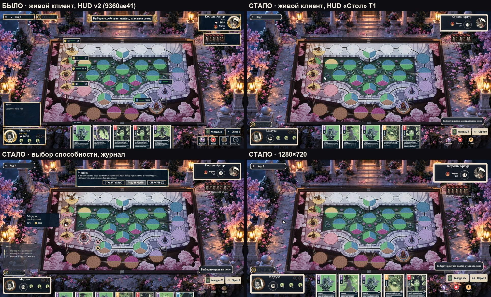
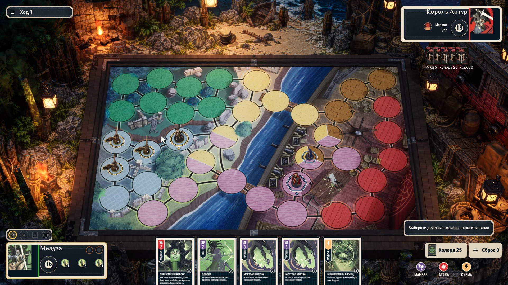
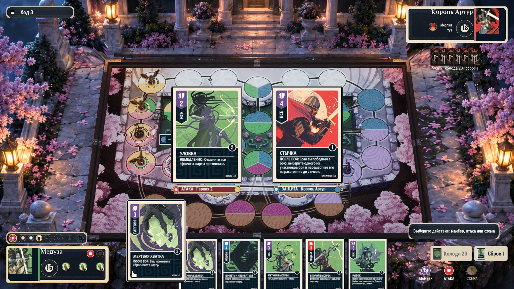

# 07 · Срез «Стол» в игре (2026-10-16)

Цель пользователя — чтобы игра **реально** стала выглядеть лучше, а не только документы. Поэтому первый срез концепта
v2 сделан сразу в клиенте UE5, по рекомендациям U-1…U-8 ([06 §8](06-REVIEW-RESOLUTION.md)): материал T1 (канон
коробки), автопередача хода, сердце → диск HP, HP над фигурами только у раненых и в выборе цели. Вид — по
умолчанию (правило AGENTS «принятый арт по умолчанию»); старый вид HUD v2 — флагом **`-S08HudTableLegacy`**.

## Что изменилось на экране

| Было (HUD v2, 9360ae41) | Стало («Стол» T1) | Где в коде |
|---|---|---|
| Теги HP над всеми шестью фигурами | тег только у раненого, наведённого/выбранного, цели атаки и кандидатов атаки | `S08FlowGameMode.cpp` `UpdateBoardLabels` |
| Мраморные панели с лавровыми медальонами, «♥ 16/16», «ВАШ ХОД» / «ЖДЁТ» | карточка героя 380 su в материале коробки (кремовая вырубная кромка + меандр), диск здоровья с одним числом, без лавров и слов статуса (кроме «ИИ ДУМАЕТ» / «ВНЕ ИГРЫ») | `UmHudPlayerPanel.*` |
| Гарпии с «1/1» под каждой | номер 1–3 без «1/1» (однохитовые помощники) | `UmHudPlayerPanel.cpp` |
| Картуш-подсказка с меандрами сверху по центру | строка-вопрос в колонке решений справа над колодой (полоса T1) | `UmHudLayout.cpp`, `UmHudStatusLine.cpp` |
| Полоса стадий хода в верхней строке | полоса над своей карточкой героя (материал T1) | `UmHudLayout.cpp`, `UmHudTurnStrip.cpp` |
| Пустой журнал «Событий пока нет» в рамке | журнал скрыт, пока пуст; затем — текст на мягкой тёмной вуали, над полосой стадий | `UmHudLog.cpp` |
| Квадратные мраморные оправы дисков действий, «КОНЕЦ ХОДА» всегда | голые диски DE-012 с подписями; «Конец хода» только когда сервер его разрешает | `UmButton.cpp`, `UmHudActions.cpp` |
| Плитки «Колода 25» / «Сброс 0» в мраморе | бумажные бирки T1 с печатной краской | `UmButton.*`, `UmHudDecks.cpp` |
| Рука в мраморном лотке + ярлык «Рука 5/7» | карты лежат на столе; число руки — только при переполнении | `UmHudHand.cpp` |
| Рука соперника в рамке | рубашки на краю стола без рамки | `UmHudOppHand.cpp` |
| Значок сигнала сети всегда | только при проблеме со связью | `UmHudTop.cpp` |

Скины T1 — `art/imagegen/hud-table-t1` (из образцов Codex ImageGen `hud-table-materials-codex/R3`), импорт
`tools/art/hud_table_import.py` в `DA_UmHudTheme`: ключи `hud.table.card`, `.strip`, `.slip`, `.dial`.

## Проверка

- Живой клиент (Live Coding, VS AI, Medusa vs King Arthur, Marmoreal): начало хода, атака (выбор атакующего), манёвр
  без движения ×2, ход ИИ, выбор способности Медузы в начале хода, журнал с событиями — кадры `frames/live-*.jpg`.
- Разрешения: 1920×1080, 1280×720, 1440×1080 (класс S), 2560×1080 — кадры `frames/live-after-*.jpg`.
- Регрессия, найденная и исправленная в ходе проверки: панель отложенного выбора и тосты привязывались к нижнему краю
  строки статуса; после её переезда вниз выбор лёг на руку. В режиме «Стол» статус больше не считается верхним
  блоком (`S08FlowGameModeUmHud.cpp`, `UmHudFeedBlocks.cpp`).
- UE-тесты `Unmatched.S08.Hud`: 127/127, включая новый `Unmatched.S08.Hud.PlayerPanel.Table` (раскладка и карточка
  «Стол»). Тесты вида HUD v2 закреплены `S08ArtLook::FHudTableTestScope(false)`.

- Упаковка: клиент перепакован на 2a90fae4 (UAT успешно), кадр собранного клиента — `frames/live-after-packaged-1080p.jpg`.

## Срез 2 (тот же день)

| Что | Где |
|---|---|
| Арт героя на всю высоту карточки вместо круглого портрета; полоса цвета героя (бэкенд `Hero.color`: Медуза `#42AB47`, Артур `#E35456`) | `UmHudPlayerPanel.cpp` `ApplyTableArt`, таблица `UmHeroColors.generated.h` из `tools/s08/hud_contract/hero_colors_codegen.py` |
| «Чей ход» — рамка карточки в цвете команды (AB-5 перенесён с кольца портрета на карточку) | там же |
| Буквы клавиш убраны из подписей («Отказаться», «Свернуть», «Подтвердить без движения», «Сбросить черновик») — клавиши работают, подсказки в тултипах | `UmButton::StripKeyHint`, `S08FlowGameMode.cpp` |
| Кнопки черновика манёвра перенесены из левого верхнего угла в колонку решений, над строкой-вопросом | `S08FlowGameModeUmHud.cpp` (сдвиг командной панели) |

Проверено живым клиентом на Marmoreal и **Sarpedon** (1920×1080, 1280×720, 1440×1080): `frames/live-s2-*.jpg`.
UE-тесты `Unmatched.S08`: 397/397.

## Срез 3 (тот же день)

| Что | Где |
|---|---|
| **Бой в центре:** от переворота до паузы обе карты стоят рядом посередине поля, ×1,15; к удару, выборам после боя и окну защиты они уезжают к краям («припаркованный» бой) | `UmHudCombatBlocks.cpp` (сдвиг и масштаб по фазе `FS09CombatStage`) |
| Журнал 18 px, без внутренних меток «Х1/Х2» | `UmHudLog.cpp` |
| «≈» убран из счётчиков колоды и руки соперника; устаревшее число печатается бледной краской | `UmHudDecks.cpp`, `UmHudOppHand.cpp` |
| Экраны вне партии (вход, лобби, комната, загрузка, итог, модальные окна) — в том же материале T1 | `UUmHudTheme::ScreenSkin`, `UmScreen*.cpp`, `UmRoomSlot.cpp` |

Кадры: `frames/live-s3-combat-centre-1080p.jpg`, `live-s3-login.jpg`, `live-s3-lobby.jpg`, `live-s3-room.jpg`,
`live-s3-feed-18px.jpg`. UE-тесты `Unmatched.S08`: 397/397.

## Срез 4 (тот же день)

- Стопки: карта колоды (рубашка) и верхняя карта сброса стоят на своих бумажных бирках, число — на бирке
  (`UmHudDecks.cpp`, `UmHudLayout.cpp`: DECKS выше на 84 su, бирки прижаты к низу).
- Счёт боя «N : M» во время дуэли стоит между двумя картами (`UmHudCombatBlocks.cpp`).
- Лобби: список игр по высоте своих строк (минимум — как колонка «Создать игру»), сцена доски видна под ним
  (`UmScreenLobby.cpp`).

Кадры `frames/live-s4-*.jpg`. UE-тесты `Unmatched.S08`: 396/397; упавший — `Screens.Pause.*`, это гонка движка
(ensure MTAccessDetector в `US08UserSettings`, известная, описана в самом тесте). Код паузы и настроек в срезах не
менялся, в прогонах срезов 1–3 этот тест проходил.

## Что ещё не сделано

- Ждём замечаний пользователя по скринам «было → стало».

## Срез 5 — слепая проверка «было/стало» (2026-10-16, 1f2524b5)

Независимый рецензент (Opus) получал два кадра 1920×1080 без подписей и не знал, какой из них старый.

| Прогон | HUD v2 (было) | HUD «Стол» | Итог |
|---|---|---|---|
| 1, срез 4 | 37 (сумма 6 оценок) | 33 | старый лучше |
| 2, срез 5 | 4,8 (среднее) | 5,75 | новый лучше на ~1 балл |

Что поменялось в срезе 5 по замечаниям первого прогона:
- карточки героев снова с круглым портретом;
- здоровье показано как «♥ 16/16» вместо голой цифры на круге;
- колода и сброс получили тёмную плашку HUD вместо кремовых бумажек;
- значок «≡» над пустым сбросом убран;
- буквы M/A/G убраны из подсказки;
- подписи под рукой соперника добавлена тень.

Открытые замечания второго прогона (ждут решения пользователя):
1. Нет надписи «ВАШ ХОД / ЖДЁТ»: о ходе говорит только свечение карточки.
2. «Конец хода» скрыт, пока закончить ход нельзя.
3. Кнопки действий и подсказка стоят без общей подложки.
4. Подпись соперника лежит вне его панели, рамка панели светлая.
5. Рука срезана нижним краем.
6. У гарпий в панели нет здоровья 1/1.
7. Два пустых кружка-трекера без подписи.

## Срез 6 — замечания второго прогона (2026-10-16, ab8519d7)

Что сделано:
- В карточке героя вернулись надписи «ВАШ ХОД» / «ЖДЁТ», свечение рамки осталось.
- «Конец хода» теперь виден всегда. Пока закончить ход нельзя, кнопка неактивна и объясняет почему.
- Четыре кнопки действий стоят на одной подложке из материала карточек героев.

Проверено вживую на 1920×1080, 1280×720 и 2560×1080. Тесты Unmatched.S08 — 397/397.

Третий слепой прогон: срез 6 — 6,25, HUD v2 — 5,25.

Открытые замечания третьего прогона (ждут решения пользователя):
1. Толстый кремовый кант у панелей напоминает мобильную игру. Предложение: тонкий металлический скос и золотые уголки.
2. Рука соперника: рубашки и подпись лежат без подложки.
3. Портреты двух героев оформлены по-разному. Имя «Король Артур» упирается в верх рамки.
4. Подсказка висит отдельно от подложки действий. Карта колоды наползает на плашку.
5. У полосы стадий хода нет подписей. Есть два пустых кружка-трекера. У гарпий не показано здоровье.
6. Рука стоит ровным рядом и срезана внизу. Предложение: веер, перекрытие, увеличение при наведении.

## Срез 7 — замечания третьего прогона (2026-10-16, 7246237a)

Сделаны все шесть пунктов:
- **Кант панелей.** Вместо толстого кремового канта — тонкий золотой скос. Его рисует `regild` в `build_kit.py`, текстуры заново импортированы. Силуэт и 9-slice не изменились.
- **Рука соперника** лежит на подложке из того же материала, что карточки героев.
- **Портреты** обоих героев в одинаковом золотом кольце. Имя отодвинуто от верхней кромки. У гарпий снова показано «1/1».
- **Шаги хода.** Кружки трекера под видом «Стол» скрыты. Полоса стадий подписывает текущий шаг: «Действие 1 из 2», «Сброс до 7 карт», «Конец хода».
- **Правая колонка** снизу вверх: действия, над ними подсказка, выше стопки. Карта стопки больше не наезжает на плашку. Кнопки черновика стоят над колонкой.
- **Рука** с лёгким веером: перекрытие 22 su, наклон 2,4° на карту, дуга. При наведении и выборе карта выпрямляется.

Тесты Unmatched.S08 — 397/397.

Четвёртый слепой прогон: срез 7 — 6,25, HUD v2 — 4,75.

Открытые замечания четвёртого прогона:
1. Подсказка мелкая (16 px). Предложение: сделать её заголовком лотка действий, кегль 22–24.
2. Колода и сброс. Предложение: стопка с толщиной и числом на ней, пустой контур карты для сброса.
3. Полоса стадий хода далеко от лотка действий. Капсула наезжает на угол рамки доски.
4. Рука срезана снизу, текст при наклоне перекошен. Предложение: угол ≤ ±4°, при наведении увеличивать карту целиком.
5. Материал панелей. Предложение: кожа или дерево, тень на стол, мелкий текст не меньше 14–15 px.

## Срез 8 — замечания четвёртого прогона (2026-10-16, c087a28d)

Что сделано:
- **Полоса стадий хода.** Компактная полоса с подписью «Действие 1 из 2» стоит вверху правой колонки, над стопками, рядом с действиями. Слева осталась только карточка героя, журнал выше неё.
- **Подсказка.** Переносится на две строки и сохраняет полный кегль, а не сжимается в одну мелкую строку.
- **Веер руки.** Наклон не больше ±4°.

Тесты Unmatched.S08 — 397/397.

Пятый слепой прогон: срез 8 — 6,25, HUD v2 — 5,08.

Итог пяти слепых прогонов (новый «Стол» против HUD v2):

| Срез | HUD v2 | Стол |
|---|---|---|
| 4 | 37 (сумма) | 33 |
| 5 | 4,8 | 5,75 |
| 6 | 5,25 | 6,25 |
| 7 | 4,75 | 6,25 |
| 8 | 5,08 | 6,25 |

Дальше прирост упёрся в арт-направление, а не в раскладку. Замечания пятого прогона — для решения пользователя:
1. **Материал панелей.** Плоский синий с золотой линией. Предложение: фактура кожи, мрамора или эмали, фаска, панели ужать по содержимому. Это новые текстуры через Codex.
2. **Значки действий.** Глянцевые цветные круги в духе мобильной казуалки. Предложение: гравированные монохромные глифы на монетном диске. Это новый набор значков, правка решения HUD v3.
3. **Колода и сброс.** Предложение: стопки с толщиной, счёт значком на рубашке, верхняя карта сброса.
4. **Рука.** Сильнее веер (±6–8°) и подъём на 40 px. Подъём упирается в нижний край поля: рука сейчас стоит вплотную к рамке доски.
5. **Команды на поле.** После снятия плашек HP не видно, чья фигура. Предложение: командная метка на подставке.
