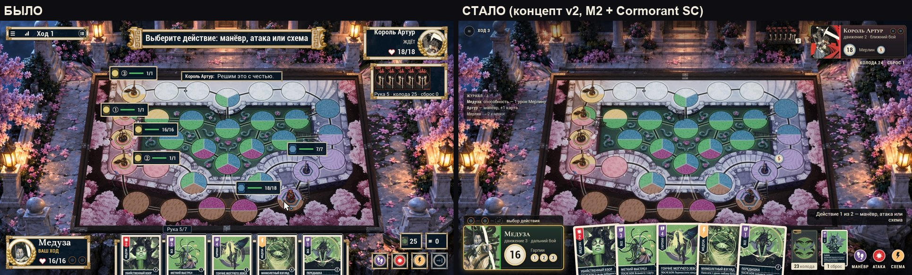
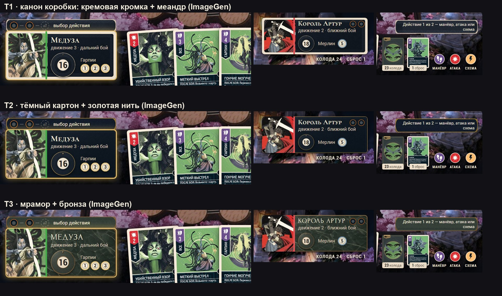

# Пересборка HUD (2026-10-16)

Запрос пользователя: HUD «выглядит откровенно по-детски… очень дёшево… нет единообразия и сходства с реальными
настольными играми, Magic the Gathering и крупными проектами… очень много лишних иконок, непонятное расположение».
Нужно: арт-директорский осмотр, ресерч workflow-агентами, концепт пересборки, адверсариальное ревью Opus xhigh и
GPT-6-Astra xhigh, всё документами.

## Как читать

| № | Документ | Что внутри |
|---|---|---|
| 01 | [01-INSPECTION.md](01-INSPECTION.md) | Осмотр текущего HUD: аннотированный кадр, 17 элементов, оценки по 10 осям (средняя 3,4/10), корневые причины, что сохранить и что убрать |
| 02 | [02-REFERENCES.md](02-REFERENCES.md) | MTG Arena, Hearthstone, LoR, Snap, Gwent, цифровые настолки, Into the Breach, Slay the Spire, Hades, Unmatched DE; 18 выводов, в которых сходятся отчёты |
| 03 | [03-CONCEPT.md](03-CONCEPT.md) | **Концепт v2 «Стол, а не приложение»** (после ревью): 10 правил, композиция L и S, компоненты, 21 состояние хода, материал по образцам, движение и звук, план с оценкой в часах |
| 04 | [04-REVIEW-OPUS.md](04-REVIEW-OPUS.md) | Адверсариальное ревью Opus xhigh концепта v1: 31 находка, 4/10 как есть |
| 05 | [05-REVIEW-ASTRA.md](05-REVIEW-ASTRA.md) | Адверсариальное ревью GPT-6-Astra xhigh (Codex) концепта v1: 25 находок, 4/10 |
| 07 | [07-SLICE-IN-GAME.md](07-SLICE-IN-GAME.md) | **Срез «Стол» уже в игре**: что изменилось на экране, где в коде, флаг отката `-S08HudTableLegacy`, проверка, что дальше |
| 06 | [06-REVIEW-RESOLUTION.md](06-REVIEW-RESOLUTION.md) | Разбор ревью: что принято и как исправлено, что отклонено, честный счёт по кадрам, изменения лично принятых решений, **вопросы U-1…U-8** |
| — | [research/](research/) | 8 отчётов: I1 перепись HUD, I2 история итераций, R1–R6 ресерч (CCG, адаптации настолок, Unmatched DE и коробка, тактики, арт-дирекшн, UX хода) |
| — | [mockups/](mockups/) | 22 макета на реальном кадре и реальных картах (листы `SHEET-*`) |
| — | [frames/](frames/) | Кадр текущего HUD 1920×1080 и его разметка |
| — | [art/imagegen/hud-table-materials-codex/](../../../art/imagegen/hud-table-materials-codex/) | Образцы материала Codex ImageGen: канон коробки, тёмный картон, мрамор-бронза |

## Главное за минуту




- **Почему дёшево:** не отдельные элементы, а отсутствие системы. Около 20 одинаково обрамлённых окошек (10 видов
  рамок), 37 значков ~20 родов, 12 цветовых ролей, 3 гарнитуры и 7 кеглей; HP, «чей ход» и колода показаны по 2–7 раз.
  За три недели было пять поколений HUD, но раскладку и состав ни разу не пересматривали — только перекрашивали (I2).
- **Что делаем:** HUD становится компонентами коробки Unmatched на краю стола — карточка героя в цвете героя с
  диском здоровья, полоса стадий хода с жетонами действий, рука, стопки колоды и сброса — в материале самих карт
  (кремовая кромка, тёмное тело, меандр). Один вопрос и одна главная кнопка в колонке решений справа, бой в центре и
  «припаркованный» бой для выборов, над полем ничего постоянного. Правила игры не меняются.
- **Цифры (06 §5):** значков 37 → 16 (резерв до 12), видов рамок 10 → 5, цветовых ролей 12 → 4 + цвета героев,
  кеглей 7 → 5, текст ≥ 18 px на всех классах разрешений.
- **Ревью:** оба ревьюера поставили концепту v1 4/10 и сошлись в главном (нелегальный конец хода, выдуманные значения
  в макетах, только 1920 px, материал из CSS, нарушение собственных правил). Всё это исправлено в v2 (06 §2–3).
- **Что нужно от пользователя:** 8 решений U-1…U-8 ([06 §8](06-REVIEW-RESOLUTION.md)). Главные: материал (рекомендация
  T1 — канон коробки), судьба полосы стадий HB-50, сердце → диск здоровья. Затем — вертикальный срез на живом
  клиенте под флагом и личная приёмка направления до остального производства (03 §9).



## Как пересобрать макеты

```bash
python docs/game-design/hud-redesign/mockups/gen_table.py && python docs/game-design/hud-redesign/mockups/render.py && python docs/game-design/hud-redesign/mockups/sheets.py
```

Нужны Playwright (Chromium) и локальные медиа `scraped-data/derived/ue-media-v1` (вне git). Шрифты Cormorant SC и
Forum подгружаются с Google Fonts при рендере.
